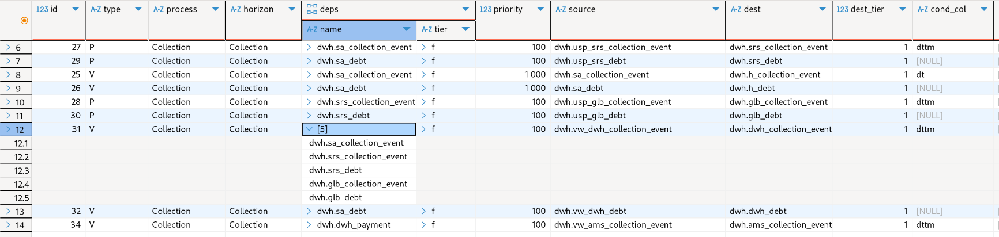

# ssdf
## super SQL data flow

tool/framework for realization of the SQL data flow (ETL): the flow is described in SQL tables, the execution logic is SQL, and the launcher is Python[^1]. It uses PostgreSQL.

### Requirements
- PostgreSQL (tested on 18).
- Python 3 with [psycopg](https://www.psycopg.org/) (v3) - the PostgreSQL driver for Python. Install it however you prefer (system package manager, pip, etc.).

### deploying
**SQL part - apply install.sql via psql yourself.** The installers use `\i` with relative paths, so run them from their own directories ("demo" is just the example name).
framework:
```
cd framework
psql -d demo -f install.sql
```
example (sample DWH and ETL. No real-like data - only for test framework): 
```
cd ../example
psql -d demo -f install.sql
```
Notice: probably you will need provide special authorization to psql, by options or other way.

Uninstall SQL: `example/uninstall.sql` first (removes the example flow/horizon rows and drops `dwh`), then `framework/uninstall.sql` (drops `df` — all logs and history go with it, irreversible).

**Python launcher** - `install.sh` puts executable `.py` scripts into `/opt/ssdf` (they carry a `#!/usr/bin/env python3` shebang and the exec bit, so they run directly, no wrappers). It does not touch the database.
```
chmod +x install.sh           # make the installer executable
sudo ./install.sh             # call as /opt/ssdf/ssdf.py
sudo ./install.sh --path      # + symlinks in /usr/local/bin: ssdf.py callable from any folder
```
Uninstall: `chmod +x uninstall.sh` then `sudo ./uninstall.sh` (removes `/opt/ssdf` and the `/usr/local/bin` symlinks).
Without install, from the project: `python3 framework/python/ssdf.py ...` (psycopg must be importable).

### short description
project includes SQL/Python code of the tool, sample data flow, and sample DWH for sample data flow.\
Project have 2 main features:
1) describing points of SQL data flow in setting table, where your have source and destination and code generation for them.
2) describing dependencies between points of SQL data flow directly as is and calculating fact order of execution at the moment of execution.
3) also I hope that SQL realization of the tool quite tranparent (see df.exec_id proc) and it could be modified for various needs, for example, types of points of data flow.

how it looks:\


### description
so, we have table for describing SQL data flow:
```sql
select * from df.flow
```
If you want to do changes in flow, you should directly insert/update to `df.flow`.\
\
Point types\
\"P\" - procedure. It works as call \_source\_(id_batch)\
\"V\" - view. It works as insert into dest select from view in source. Column names of view must match dest (order not important).\
\"StrtF\" - starting function. It suppose to use for waiting a source and returning its rep date.\
Call looks like:
```sql
select dwh.uf_sa_wait_contact_collection_event()
--2026-11-24 00:00:00.000
```
so, as you see, function should return apropriate REP DATE; `df.exec_id` stores it in `df.flow_rep_dttm`. Destination of a StrtF point is the sources of the next-in-chain points of the flow; it needed for passing REP DATE higher by flow.
\
The horizon table `df.horizon` (for now, only ddtm's is functional)\. `df.exec_id` uses it for constructing datetime condition on target SQL.
\
Also, as you can see, tool have one mini feature - tier of the point of data flow. What is this?\
For example, you have big table, which builds for many stages. Tier of the point uses special type - `df.point` - with 2 fields - name of table and building stage of it. So, you can address each stage of building of the table for further using it as dependencie. If you want address final stage, use "f" (only in dependencies, in targets you only use numbers, because "f" calculates at moment (as last existing stage).\
\
In tool, presents one thing - rep date. Each point when executing, rep date calculating for. It uses for information, and, for calculating points of dataflow will executed (further will be about). See table `df.flow_rep_dttm` - one row per point of flow, with rep date, up to that the point is loaded. Rep date of a destination (stage) is min of rep dates of points, building it, and it is known only when all of them reported - see view `df.vw_dest_rep_dttm`. Also table `df.flow_rep_dttm_clc` keeps contributions of points per batch, for multi-tier readiness of a destination.\
\
and we have a view, calculating order of executing data flow:
```sql
select * from df.vw_flow;
```
view has following calculated fields:
- `dest_tier_f` - replaces value of dest_tier by "f" if it last point(s) for building destination.
- `vw_ordr` - first number, at that point can be already executed.
- `vw_ordr_max` - last number, at that point can be executed.

So we can see, order of execution is undefined. On the idea, it resolves at moment of execution by the available resources/priorites of the points. Degree of parallelism undefined for now (for future: wiil can be set by setting)\
`priority` using in case when we can launch, 2 points for example, but have only 1 free thread - so point with higher 'priority' will be.\

Load modes: "strict" or "full". Difference between then is in what in "strict" mode point is executed when all of it dependencies are executed in current batch (or have newer rep date) and in "full" mode only one dependencie (executed or has newer rep date) is enough.\
Handling errors: errors handles as excluded from flow points - dependents are disabled according to the load mode politics.

### Python launcher
`framework/python/ssdf.py`_/opt/ssdf/ssdf.py

Parameters:
- `--mode` - "strict" or "full" (see Load modes above).
- `--procs` - array of names of processes. Process, here (in tool) is conditional way for separate different workload, but by default, data flow consider at all. So, if it null, data flow consider at all, if it given, data flow limits by given processes.
- `--start-ids`. If it null, data flow starts by points having no dependencies, if it given - by then.
- `--dests` - destinations (name:tier), that is will not generate data flow after them.
- `--excls` - points (name:tier), to be excluded from executing data flow.
- `--no-rep-dttm` - do not use rep date for calculating dependecies (if given, it will be considered only dependencies, runned in the batch). Rep dates are still recorded - the flag only excludes them from the calculation.
- connection options: `--dbname` (default "demo"), `--host`, `--port`, `--user`.

some internals\
the launcher calculates the closure of points to run (by dependencies and rep dates) and writes the plan into table `df.batch_log` for current batch.\
Then it executes points in waves: each point runs in its own thread with its own client connection, via `df.exec_id`.\
In case when the launcher see the error in runned code - it disables all related points of data flow (according to load mode politics - strict or full).\
Batch state transitions are serialized with a PostgreSQL advisory lock; the points themselves execute outside the lock, in parallel.\
\
`df.exec_id(in _id_batch bigint, in _id int, out _strt_dt timestamp)` - procedure, which executes given point of data flow. The launcher calls it for every point; it can be called also when you test created point in development.\
Logs:
- `select * from df.exec_log el order by startdate desc;` - log of SQL code execution
- `select * from df.batch_log order by id_batch desc, vw_ordr, priority, id;` - plan and state of points per batch
- `select * from df.dbg order by msg;` - trace of the wave walker

### examples
adding horizon:
```sql
insert into df.horizon (name, dttm, dttm_end, dttm_type, id, id_end)
select 'Collection', '2025-01-01', null, 'DTTM', null, null;
```
adding point of data flow:
```sql
insert into df.flow (type, process, horizon, deps, priority, source, dest, dest_tier, cond_col, rep_dttm_col)
select 'StrtF', 'Collection', null, null, 100, 'dwh.uf_sa_wait_contact_collection_event', 'dwh.usp_sa_load_contact_collection_event'
	, 1, null, null;
```
executing point (development test):
```sql
do $$
declare _d timestamp;
begin
call df.exec_id(0, 25, _d);
end
$$;
```
executing flow (with `--path`; otherwise `/opt/ssdf/ssdf.py`, or from the project `python3 framework/python/ssdf.py`):
```
# full flow in strict mode
ssdf.py --mode strict
# full flow in full mode
ssdf.py --mode full
# full flow starting from point id=4 in strict mode
ssdf.py --mode strict --start-ids 4
# process "Collection" in full mode
ssdf.py --mode full --procs Collection
# process "Collection" in strict mode
ssdf.py --mode strict --procs Collection
```
test scenarios (need the example DWH): `example/test/python/all_execs.py`, installed as `/opt/ssdf/test/example/all_execs.py`:
```
/opt/ssdf/test/example/all_execs.py             # resets df log tables between runs
/opt/ssdf/test/example/all_execs.py --no-reset  # keep state between runs (for inspection; expectations assume a clean state)
```
The test script finds `ssdf.py` both in the repo layout and in `/opt/ssdf` (test in `/opt/ssdf/test/example`).

### admin: cleaning stuck points
User errors in SQL workload are handled by `df.exec_id` itself (the point becomes error and dependents are disabled). But a system fault (network drop, server reboot, launcher crash) can leave points in `df.batch_log.executed='running'` without a live thread. Such tails are closed manually, as error with 'system fault'.

Python script (interactive):
```
ssdf_admin_clean_err_tail.py   # lists running points with numbers, asks which to close (0 - all, empty - cancel)
```
SQL functions (same numbering):
```sql
select * from df.list_running();               -- running points with numbers
select * from df.close_running(array[1, 2]);   -- close selected; array[0] - all
```
Closed points become error with `_sqlerrm='system fault'` in `df.batch_log`; phantom 'running' rows in `df.exec_log` are closed too (real done/error history is preserved). Closing only fixes the state - it does not disable dependents and does not continue the batch.


[^1]: idea was in clean SQL, but during of the technical characteristic of the Postgres tools, providing threading capability - preffered the Python using clients connection pool. 